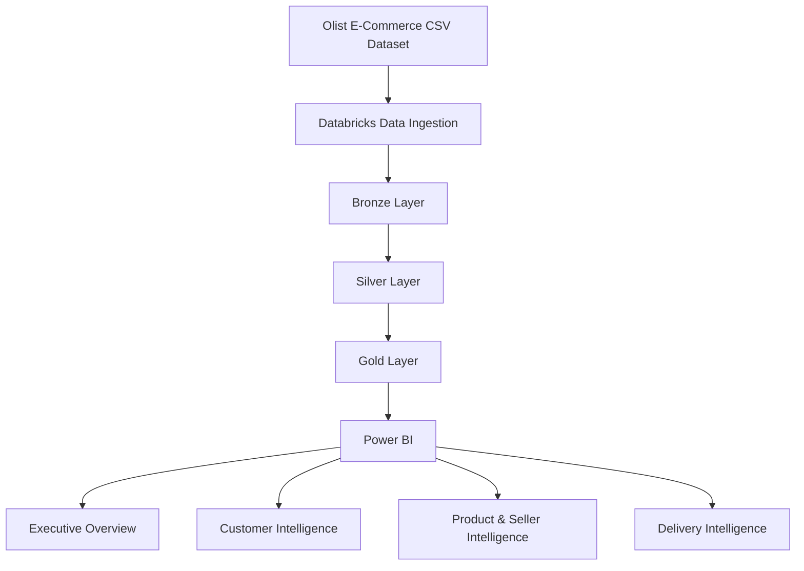
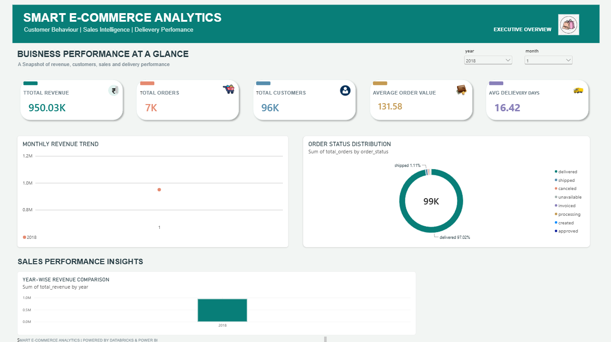
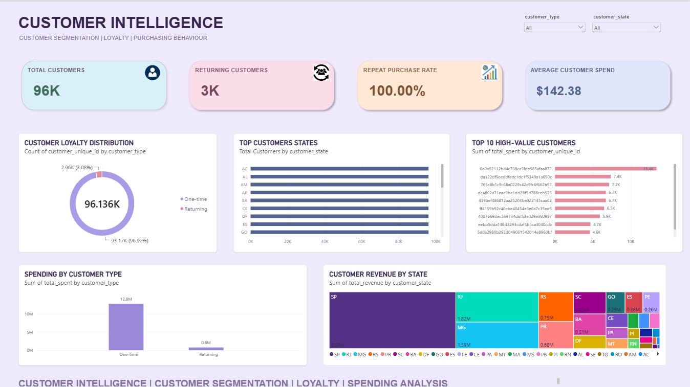
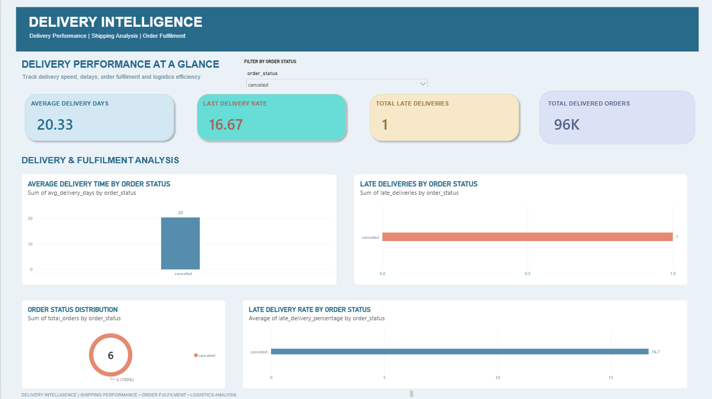

# 🛒 Smart E-Commerce Analytics
### An End-to-End Data Engineering Pipeline for Customer Behaviour, Sales Intelligence and Delivery Performance


## 📌 Project Overview

Smart E-Commerce Analytics is an end-to-end data engineering and business intelligence project designed to transform raw e-commerce data into meaningful business insights.

The project uses the Brazilian E-Commerce Public Dataset by Olist and implements a Medallion Architecture (Bronze, Silver and Gold) using Databricks and PySpark. The processed data is used to build interactive Power BI dashboards for analysing sales performance, customer behaviour, product performance, seller insights and delivery operations.

## 🎯 Objectives

- Build an end-to-end data engineering pipeline.
- Ingest and process multiple e-commerce datasets.
- Implement Bronze, Silver and Gold data layers.
- Clean and transform raw data using PySpark.
- Generate analytical Gold tables for business intelligence.
- Develop interactive Power BI dashboards.
- Analyse customer purchasing behaviour and sales trends.
- Monitor delivery performance and order fulfilment.

## 🛠️ Technologies Used

| Technology | Purpose |
|---|---|
| Python | Data processing and transformation |
| PySpark | Distributed data processing |
| Databricks | Cloud data engineering platform |
| Delta Lake | Medallion data architecture |
| Power BI | Interactive dashboards and visualisation |
| GitHub | Source code and project version control |
| CSV / JSON | Data storage and input formats |

## 📂 Dataset Description

**Dataset:** Brazilian E-Commerce Public Dataset by Olist

**Source:** [Olist Dataset on Kaggle](https://www.kaggle.com/datasets/olistbr/brazilian-ecommerce)

The dataset contains approximately 100,000 orders from the Brazilian e-commerce marketplace between 2016 and 2018.

The project uses nine source CSV files:

1. Orders
2. Customers
3. Order Items
4. Order Payments
5. Order Reviews
6. Products
7. Sellers
8. Geolocation
9. Product Category Translation

**Dataset attribution:** Brazilian E-Commerce Public Dataset by Olist, Kaggle. Licensed under CC BY-NC-SA 4.0.

## 🏗️ System Architecture

The project follows the Medallion Architecture.



### 1. Bronze Layer

- Ingests the original CSV datasets.
- Stores raw source data in the Bronze layer.
- Maintains the initial structure of the source datasets.

### 2. Silver Layer

- Performs data cleaning and transformation.
- Handles missing and inconsistent values.
- Prepares structured data for analytical processing.

### 3. Gold Layer

- Creates business-ready analytical tables.
- Aggregates data for sales, customers, products, sellers and delivery analysis.
- Provides processed data for Power BI dashboards.

## 📊 Gold Layer Tables

The pipeline generates nine analytical Gold tables:

| Gold Table | Purpose |
|---|---|
| `gold_sales_summary` | Sales and revenue analysis |
| `gold_customer_summary` | Customer purchasing behaviour |
| `gold_product_summary` | Product and category performance |
| `gold_delivery_summary` | Delivery and delay analysis |
| `gold_payment_review_summary` | Payment and review analysis |
| `gold_review_summary` | Customer review analysis |
| `gold_seller_summary` | Seller performance |
| `gold_customer_geography` | Customer geographical analysis |
| `gold_monthly_order_status` | Monthly order status analysis |

## 📈 Power BI Dashboards

The project contains four interactive dashboard pages with dynamic slicers.

### 1. Executive Overview

Provides an overall view of business performance, including revenue, orders, customers, average order value and delivery metrics.



### 2. Customer Intelligence

Analyses customer segmentation, returning customers, repeat purchase rate, customer spending and geographical distribution.



### 3. Product & Seller Intelligence

Provides insights into product categories, product revenue, units sold and seller performance.


### 4. Delivery Intelligence

Analyses average delivery time, late deliveries, delivery rates and order status distribution.



## ⚙️ Pipeline Execution and Validation

The project includes an end-to-end Databricks pipeline and an orchestration job.

**Pipeline:** `Ecommerce_Medallion_Pipeline`

**Orchestration Job:** `Smart_Ecommerce_End_to_End_Orchestration`

The orchestration workflow includes:
- Running the Medallion data pipeline.
- Executing the Gold table validation notebook.
- Checking the availability of all nine Gold tables.

All nine Gold tables were successfully validated.

## 📁 Repository Structure

```text
smart-ecommerce-analytics/
│
├── databricks/
│   ├── 01_Bronze.py
│   ├── 02_Silver.py
│   ├── 03_Gold.py
│   └── validate_gold.py
│
├── powerbi/
│   └── Smart_Ecommerce_Analytics.pbix
│
├── screenshots/
│   ├── 01_Executive_Overview.png
│   ├── 02_Customer_Intelligence.png
│   ├── 03_Product_Seller_Intelligence.png
│   ├── 04_Delivery_Intelligence.png
│   └── 05_Databricks_Pipeline_Execution.png
│
└── README.md
```

Additional Gold validation screenshots are also available in the screenshots folder.

## 🚀 Implementation Workflow

1. Download the Olist dataset from Kaggle.
2. Upload the source CSV files to a Databricks Unity Catalog Volume.
3. Execute the Bronze layer ingestion scripts.
4. Apply data cleaning and transformations in the Silver layer.
5. Generate analytical Gold tables.
6. Execute the orchestration job.
7. Validate all nine Gold tables.
8. Connect Power BI to Databricks.
9. Build interactive dashboards using the Gold tables.
10. Publish the source code and project assets to GitHub.

## 🔮 Future Scope

- Integrate real-time e-commerce data streams.
- Add predictive sales forecasting.
- Develop customer churn prediction models.
- Implement recommendation systems.
- Integrate external data sources for deeper business insights.
- Enhance automated monitoring and pipeline alerting.

## 👥 Project Information

**Project Title:** Smart E-Commerce Analytics: An End-to-End Data Engineering Pipeline for Customer Behaviour, Sales Intelligence and Delivery Performance

**Project Domain:** Big Data Analytics and Business Intelligence

**Team Size:** 4 Members
## 👥 Team Members

**Project Title:** Smart E-Commerce Analytics: An End-to-End Data Engineering Pipeline for Customer Behaviour, Sales Intelligence and Delivery Performance

**Project Domain:** Big Data Analytics and Business Intelligence

**Team Size:** 4 Members

| S. No. | Team Member Name | Roll Number |
|---:|---|---|
| 1 | Ayesha | 2401730111 |
| 2 | Priya Darshni Sinha | 2401730123 |
| 3 | Smruthi Jha | 2401730081 |
| 4 | Khyati Arora | 2401730142 |

**Academic Project:** Capstone Project

**Academic Project:** Capstone Project

## 📚 References

- [Brazilian E-Commerce Public Dataset by Olist – Kaggle](https://www.kaggle.com/datasets/olistbr/brazilian-ecommerce)
- [Databricks Documentation](https://docs.databricks.com/)
- [Apache Spark Documentation](https://spark.apache.org/docs/latest/)
- [Microsoft Power BI Documentation](https://learn.microsoft.com/en-us/power-bi/)

---

⭐ **Smart E-Commerce Analytics — Transforming E-Commerce Data into Actionable Business Intelligence.**
